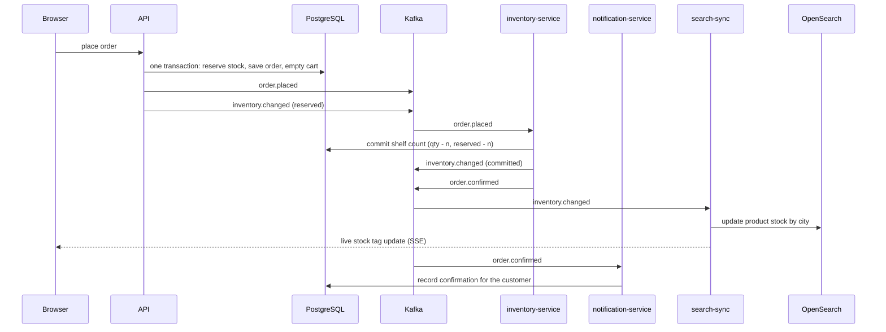

# Haat

An online store for a retail chain that is moving from physical shops to all of India.
Customers pick a city, browse and search that city's stock, add to a cart and place an order.
Every number on a stock tag is live.

OUR WEBSITE IS LIVE NOW PLEASE CLICK THE BELOW GIVEN LINK TO USE OUR WEBSITE

https://haat-1-lent.onrender.com/

Built for the "Build the Online Store" hackathon brief. PostgreSQL, Apache Kafka and OpenSearch
all do real work, and the **Ledger** page shows each of them doing it.

| Service | What it does here |
| --- | --- |
| **PostgreSQL** | Products, prices, customers, carts, orders and stock per city. Reserves stock with one conditional `UPDATE` so two buyers can never both get the last unit. `CHECK` constraints refuse an oversell even if code has a bug. |
| **Apache Kafka** | Topics `haat.orders` and `haat.inventory`. Three consumer groups react: `inventory-service`, `notification-service` and `search-sync`. |
| **OpenSearch** | Every search and suggestion. Typo tolerant (`bluetoth earphnes` finds Bluetooth earphones), filters by category, price and city, category counts, as-you-type suggestions. |

## How an order flows



Why stock is reserved at checkout and committed by the consumer: the brief wants the listener to
reduce inventory, and it also wants two people never to get the last item. Reserving in the
same transaction as the order gives both. Available stock is `qty - reserved`.

Reliability details:

- **Outbox sweep.** If PostgreSQL saved an order but publishing to Kafka failed, the order stays
  `published = false` and a sweeper publishes it a few seconds later.
- **Idempotent consumers.** `processed_events` has one row per `(event, consumer)`, and the order
  status flip is conditional, so a replayed message changes nothing.
- **Retries.** A failing handler is retried 3 times, then logged and skipped so one bad message
  cannot block a topic.
- **Index rebuild.** The OpenSearch index is rebuilt from PostgreSQL on every start.

## Run it

Needs Node 18 or newer.

```sh
npm install
cp .env.example .env     # then fill in the Aiven details below
npm start                # http://localhost:3000
```

With no `.env` values the app still runs, using clearly labelled in-memory stand-ins for any
service you have not configured. The Ledger page says which services are real and which are
stand-ins. For the hackathon demo, configure all three.

### Connect Aiven

1. Sign up at aiven.io (the free tier covers all three, no card needed). Create one **PostgreSQL**,
   one **Apache Kafka** and one **OpenSearch** service.
2. **PostgreSQL:** copy the *Service URI* into `DATABASE_URL`.
3. **Kafka:** copy host and port into `KAFKA_BROKERS`. Download `ca.pem`, `service.cert` and
   `service.key` from the service page into a `certs/` folder (it is git-ignored). Or enable SASL
   and set the `KAFKA_SASL_*` values instead.
4. **OpenSearch:** copy the *Service URI*, which includes the credentials, into `OPENSEARCH_URL`.
5. `npm start`. The first lines in the console say `Aiven` for each service that connected.

Credentials only ever live in `.env` or in your host's environment variables. `.env` and `certs/`
are in `.gitignore`.

### Deploy

Any Node host works (Render, Railway, Fly). Set the same variables from `.env.example` as
environment variables and run `npm start`. The server is one process that serves the site, the
API and the three consumers. The certificates can be passed as PEM text in `KAFKA_CA`,
`KAFKA_CERT` and `KAFKA_KEY` instead of file paths.

## Demo script (3 minutes)

1. **Home.** Point at the tag hanging in the hero. Its count is live.
2. **Search.** Type `bluetoth earphnes`. Suggestions and results come from OpenSearch, and the
   page shows the query time. Filter by category and price, switch city in the header.
3. **Product.** Open a product, see stock in all eight cities.
4. **Order.** Add to cart, check out. The order page shows the receipt and then, line by line, the
   PostgreSQL write, the Kafka events, the consumers reacting, the OpenSearch update and the
   confirmation.
5. **Ledger.** Open `Ledger` in a second window next to a product page. Press **Run the race**:
   several buyers go for one unit. One wins, the rest are turned away, and the tag on the open
   product page flips to `Sold out` by itself.

From a terminal: `node scripts/race.js 25 1` sends 25 buyers after one unit.

## Tests

```sh
npm test
```

Runs on the in-memory stand-ins (never your Aiven services). It checks typo search and the
category, price and city filters, the full order flow through every consumer, replay safety, the
cart cap, 20 buyers racing for 3 units and the database `CHECK` constraint.

Note: the in-memory PostgreSQL stand-in runs transactions one at a time, so the race test proves
the application logic. On real PostgreSQL the same guarantee comes from the conditional
`UPDATE ... WHERE qty - reserved >= n` taking a row lock.

## Layout

```
server/
  index.js        Express app and boot
  services.js     connects the three services, rebuilds the index, starts consumers
  db.js           schema, seed, transactions (Aiven PostgreSQL or stand-in)
  bus.js          Kafka producer and consumers (Aiven Kafka or stand-in)
  search.js       OpenSearch mapping and queries (Aiven OpenSearch or stand-in)
  store.js        carts, orders, stock reservation, what the consumers do
  consumers.js    the three consumer groups
  api.js          HTTP API and the live event stream (SSE)
  ledger.js       the record of what every service did
public/           storefront (plain ES modules, no build step)
scripts/          test, race, screenshots, asset build
```

## Design

The interface follows the **unslop** design process by Damir Sokolovsky ([@heydamir](https://x.com/heydamir),
CC BY 4.0): find a direction from the product, then spacing, color, icons, copy, type, layout,
details, visuals and motion, in that order.

- **Product.** The online store of a retail chain, for shoppers in eight Indian cities.
- **Character.** Practical, exact, a little warm.
- **World.** A shop shelf: kraft paper, price tags, a ledger behind the counter.
- **Moments.** The shelf scene in the hero with its hanging price tag, the product artwork (the
  only saturated colour on a page), and the paper receipt on the order page.
- **Signature.** The stock tag. A hang-tag shaped label in mono type whose number changes the
  moment stock does, used on every product and nowhere else.

Warm neutral ramp, one terracotta accent, Instrument Sans with Instrument Serif for the hero
headline and JetBrains Mono for figures. Product artwork is drawn in code so no image files
are needed. Icons are lucide (ISC), fonts are self-hosted from Fontsource.
